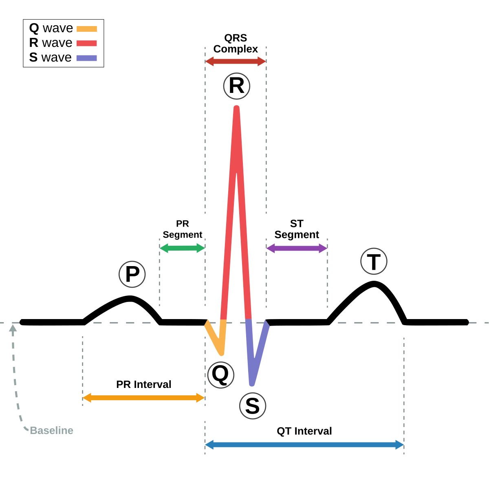

[웹 렌더링](https://jnu-triage-2025.github.io/patient-monitor-graphs/ecg/)

 

경험적으로 측정되는 그래프 개형을 수학적으로 근사하기란 쉽지 않다. 무선 채널 잡음에서 비롯된 신호 소실과 같은 것들은 나름의 직관적인 논리와 메커니즘을 근거로 상대적으로 간단한 형태로 모델링할 수 있다. 하지만 심박 그래프는 수학적인 연관성을 관계짓기 어렵고, A 상황에서는 B 하는 경향이 있다는 경험적 관찰이 주요하여, 그 관찰을 수학적으로 표현하는 것이 쉽지 않다.  

나는 어떤 연구 과제에서 심박 상황을 표현하는 변수에 따라 실시간으로 변하는 심박 그래프를 렌더할 필요가 있었다. 그래서 심박 그래프를 수학적으로 표현하는 방법을 고민하게 되었다.

## 심박 그래프의 이해

_[심박 그래프의 개형](https://en.wikipedia.org/wiki/Electrocardiography)_  

심박 그래프는 baseline을 기준으로 P파, QRS파, T파로 구성되고, 이들 파형의 분포에 따라 T파 바로 뒤에 나타나는 작고 둥근 파형인 U파, P파 끝과 QRS파 시작 사이의 PR segment, S파와 T파 사이의 ST segment, QRS파 시작으로부터 T파 끝까지의 시간인 QT interval 등이 추가로 고려된다. 대개 상대적으로 완만한 P파와 T파 사이에 급격한 QRS파가 나타나며, 이 QRS파의 폭과 높이, 그리고 P파와 T파의 위치와 모양이 심박 그래프의 주요한 특징을 결정한다.  

### 심박 그래프를 표현하는 변수 설정

나는 심박 그래프를 표현하는 데 있어서, 다음의 변수들을 설정하여 사용하였다.  

- 시간 영역
  - 심박수 (BPM, Beats Per Minute)
  - 심박 불규칙성 (Arrhythmia)
- 전압 영역
  - P파 높이 (Atrial)
  - T파 높이 (Repolarization)
  - U파 높이 (Hypokalemia)
  - ST segment 높이 (Ischemia)
  - 노이즈 (Artifacts)

기능 상 요구사항으로 고려되지 않아, 각 파형의 폭은 따로 조절 가능한 매개변수로 두지 않았다. QRS파의 높이도 조절 가능한 매개변수로 두지 않았는데, QRS의 높이를 고정하더라도 다른 매개변수에 의해 그래프의 개형이 결정되므로, QRS파의 높이는 그래프 전체를 스케일링하는 것으로 충분하다고 판단하였다. 하지만 QRS파의 높이를 바꾸려고 다른 매개변수들을 모두 수정하는 것보다, QRS파의 높이를 매개변수로 추가하는 것이 더 나았을 것이라고 생각한다.  

## 심박 그래프의 구현

### 가우스 기저 함수

그래프의 주요한 곡선 표현에는 가우스 기저 함수를 사용하였다. 가우스 기저 함수는 종 모양의 곡선으로, 심박 그래프의 P파, QRS파, T파, U파를 표현하는 데 유용하게 사용할 수 있었다.  

박동 기준 상대 시간 $\tau$ 에 대해 진폭 $A$, 중심 위치 $\mu$, 폭 $\sigma$ 를 매개변수로 곡선을 그리는 가우스 기저 함수는 다음과 같이 정의된다.  

$$
\ttip{G(\ttip{\tau}{박동 기준 상대 시간 $\tau$ (s). R파 꼭짓점이 $\tau = 0$ 이다.};\,\ttip{\mu}{중심 위치 $\mu$ (s)}, \ttip{A}{진폭 $A$ (mV). 음수이면 아래로 향하는 파형이다.}, \ttip{\sigma}{폭 $\sigma$ (s). 중심에서 변곡점까지의 거리이다.})}{진폭 $A$, 중심 위치 $\mu$, 폭 $\sigma$ 를 매개변수로 곡선을 그리는 가우스 기저 함수 $G$} =
\begin{cases}
\ttip{A\,\exp\!\left(-\dfrac{(\tau-\mu)^2}{2\sigma^2}\right)}{가우스 기저 함수. $\tau = \mu$ 에서 꼭짓점 높이 $A$ 를 갖는다.}, & \sigma \neq 0 \\[4pt]
0, & \sigma = 0
\end{cases}
$$

<!--
$$
G(\tau;\,\mu, A, \sigma) =
\begin{cases}
A\,\exp\!\left(-\dfrac{(\tau-\mu)^2}{2\sigma^2}\right), & \sigma \neq 0 \\[4pt]
0, & \sigma = 0
\end{cases}
$$
-->

### 각 파형의 가우스 기저 함수 표현

개별 파형은 $G(\tau;\mu,A,\sigma)$ 를 사용해 정의하였다. P파, QRS파(Q, R, S 각각), T파, U파, ST segment는 $G$ 에 대해 아래와 같이 표현하고, ST segment 항은 $G$ 에 구간을 지시하는 지시함수를 추가로 동원하였다. 모든 중심과 폭의 단위는 초(s)이고, $\lambda$ 는 QRS 폭 배율이다.  

$$
\begin{aligned}
\ttip{P(\tau)}{P파: 심방 탈분극}  &= G(\tau;\,\ttip{-0.16}{R파보다 0.16초 앞},\;\ttip{A_P}{P파 높이. 조절 변수},\;\ttip{\sigma_P}{P파 폭. 프리셋마다 고정}) \\
\ttip{Q(\tau)}{Q파: QRS파의 첫 음의 편향}  &= G(\tau;\,-0.04\ttip{\lambda}{QRS 폭 배율. 기본값 1},\;A_Q,\;0.02\lambda) \\
\ttip{R(\tau)}{R파: QRS파의 주된 양의 편향. 박동 시각 $t_k$ 의 기준점이다.}  &= G(\tau;\,0,\;A_R,\;0.03\lambda) \\
\ttip{S(\tau)}{S파: R파 뒤의 음의 편향}  &= G(\tau;\,0.04\lambda,\;A_S,\;0.03\lambda) \\
\ttip{ST(\tau)}{ST segment 항. 허혈 시 상승하거나 하강한다.} &= G(\tau;\,0.15,\;\ttip{h}{ST segment 높이. 조절 변수},\;0.1)\cdot \ttip{\mathbb{1}_{(0.08,\,0.25)}(\tau)}{$0.08 < \tau < 0.25$ 에서만 1인 지시함수.} \\
\ttip{T(\tau)}{T파: 심실 재분극}  &= G(\tau;\,0.25,\;\ttip{A_T}{T파 높이. 조절 변수},\;\ttip{\sigma_T}{T파 폭. 프리셋마다 고정}) \\
\ttip{U(\tau)}{U파: 저칼륨혈증에서 두드러진다}  &= G(\tau;\,0.45,\;\ttip{A_U}{U파 높이. 조절 변수},\;0.06)
\end{aligned}
$$

<!--
$$
\begin{aligned}
P(\tau)  &= G(\tau;\,-0.16,\;A_P,\;\sigma_P) \\
Q(\tau)  &= G(\tau;\,-0.04\lambda,\;A_Q,\;0.02\lambda) \\
R(\tau)  &= G(\tau;\,0,\;A_R,\;0.03\lambda) \\
S(\tau)  &= G(\tau;\,0.04\lambda,\;A_S,\;0.03\lambda) \\
ST(\tau) &= G(\tau;\,0.15,\;h,\;0.1)\cdot \mathbb{1}_{(0.08,\,0.25)}(\tau) \\
T(\tau)  &= G(\tau;\,0.25,\;A_T,\;\sigma_T) \\
U(\tau)  &= G(\tau;\,0.45,\;A_U,\;0.06)
\end{aligned}
$$
-->

### 한 사이클에서 각 파형의 합

$$
\begin{aligned}
\ttip{B(\tau)}{한 박동의 파형. R파 꼭짓점을 $\tau = 0$ 으로 둔다.} &= \ttip{\sum_{i \in \{\ttip{P}{P파},\ttip{Q}{Q파},\ttip{R}{R파},\ttip{S}{S파},\ttip{T}{T파},\ttip{U}{U파}\}} G(\tau;\,\ttip{\mu_i}{각 파형의 중심}, \ttip{A_i}{각 파형의 높이}, \ttip{\sigma_i}{각 파형의 폭})}{여섯 가우스 성분의 합}
\;\\
&+\; \ttip{G(\tau;\,0.15,\,h,\,0.1)\,\mathbb{1}_{(0.08,\,0.25)}(\tau)}{ST segment 항}
\end{aligned}
$$

<!--
$$
\begin{aligned}
B(\tau) &= \sum_{i \in \{P,Q,R,S,T,U\}} G(\tau;\,\mu_i, A_i, \sigma_i)
\;\\
&+\; G(\tau;\,0.15,\,h,\,0.1)\,\mathbb{1}_{(0.08,\,0.25)}(\tau)
\end{aligned}
$$
-->

| $i$ | $\mu_i$ | $A_i$ | $\sigma_i$ |
| :-: | :-: | :-: | :-: |
| $P$ | $-0.16$ | $A_P$ | $\sigma_P$ |
| $Q$ | $-0.04\lambda$ | $A_Q$ | $0.02\lambda$ |
| $R$ | $0$ | $A_R$ | $0.03\lambda$ |
| $S$ | $0.04\lambda$ | $A_S$ | $0.03\lambda$ |
| $T$ | $0.25$ | $A_T$ | $\sigma_T$ |
| $U$ | $0.45$ | $A_U$ | $0.06$ |

### 심박의 박동 항

위의 합 파형에서 $\tau$ 는 $k$ 번째 박동 시각 $t_k$ 로부터 잰 상대 시간 $\tau = t - t_k$ 이다. 박동 시각은 $HR$ (심박수, BPM)와 $\iota$ (심박 불규칙성, Arrhythmia)를 매개변수로 하는 박동 항이 정한다. 기준 박동 간격 $RR_0$ 와 박동 간격의 변동 $\varepsilon_k$ 는 다음과 같다.

$$
\ttip{RR_0}{기준 박동 간격 (s)} = \frac{60}{\ttip{HR}{심박수 (bpm)}}
$$

<!--
$$
RR_0 = \frac{60}{HR}
$$
-->

$$
\ttip{\varepsilon_k}{$k$ 번째 박동 간격의 변동 (s)} = (\ttip{u_k}{박동마다 새로 생성하는 0과 1 사이의 균등분포 난수} - 0.5)\,\ttip{\iota}{불규칙성 스케일 계수}\,RR_0
$$

<!--
$$
\varepsilon_k = (u_k - 0.5)\,\iota\,RR_0
$$
-->

$$
u_k \sim \mathcal{U}(0,1)
\;\;\Longleftrightarrow\;\;
\ttip{\varepsilon_k \sim \mathcal{U}\!\left(-\tfrac{\iota \tta{\ttip{RR_0}{기준 박동 간격 (s)}}{rr0}}{2},\; \tfrac{\iota \ttc{RR_0}{rr0}}{2}\right)}{변동은 기준 간격의 $\pm\iota/2$ 배 범위에서 고르게 분포하고, 박동마다 독립이다.}
$$

<!--
$$
u_k \sim \mathcal{U}(0,1)
\;\;\Longleftrightarrow\;\;
\varepsilon_k \sim \mathcal{U}\!\left(-\tfrac{\iota RR_0}{2},\; \tfrac{\iota RR_0}{2}\right)
$$
-->

임의로 정의한 초기 값

$$
\ttip{t_0}{첫 R파 시각 (s). 첫 박동의 P파($\tau = -0.16$)가 그래프에 표시되도록 하였다.} = 0.2
$$

<!--
$$
t_0 = 0.2
$$
-->

에 대해서 박동 시각은 다음과 같이 쌓인다.

$$
\ttip{t_{k+1}}{다음 R파 시각} = t_k + \ttip{\max\!\left(0.2,\; \ttip{RR_0}{기준 박동 간격 (s)} + \varepsilon_k\right)}{박동 간격. 0.2초보다 짧아지지 않는다.}
$$

<!--
$$
t_{k+1} = t_k + \max\!\left(0.2,\; RR_0 + \varepsilon_k\right)
$$
-->

박동 사이 간격의 하한은 0.2초로 제한하였다. 이렇게 하한을 지정함으로써 순간 심박수는 최대 300 bpm으로 제한된다. 300 bpm을 넘는 심실 박동은 임상적으로 드물고, 심박 그래프의 개형을 표현하는 데에도 필요하지 않다고 판단하였다.  

가장 짧은 간격은 $RR_0(1 - \iota/2)$ 이므로, 하한은 $RR_0(1 - \iota/2) < 0.2$, 즉 $\iota > 2 - HR/150$ 일 때만 작동한다. $\iota \le 1$ 이면 $HR > 150$ 일 때부터 작동한다. 하한이 작동하면 짧은 간격이 0.2초로 올라가므로 평균 박동 간격이 $RR_0$ 보다 길어지고, 평균 심박수는 설정한 $HR$ 보다 낮아진다.  

### 합성된 최종 파형

샘플링 주파수 $f_s$ 와 샘플링 시간 $t_n$ 을 다음과 같이 정의하여 파형을 샘플링할 수 있다.  

$$
\ttip{t_n}{$n$ 번째 샘플 시각 (s)} = \frac{n}{f_s}
$$

<!--
$$
t_n = \frac{n}{f_s}
$$
-->

$$
\ttip{f_s}{샘플링 주파수. 샘플 간격은 10 ms이다.} = 100\ \text{Hz}
$$

<!--
$$
f_s = 100\ \text{Hz}
$$
-->

$$
n = 0, 1, \dots, 399\ \ (\ttip{D}{화면에 그리는 구간 길이} = 4\ \text{s})
$$

<!--
$$
n = 0, 1, \dots, 399\ \ (D = 4\ \text{s})
$$
-->

R파($\sigma = 0.03$ s)의 꼭짓점과 가장 가까운 샘플은 최대 5 ms 떨어져 있으므로, 샘플에 찍히는 R파 높이는 실제 꼭짓점보다 최대 약 1.4% 낮다. 화면 표시용으로는 충분한 해상도이다.  

 

측정 시의 잡음을 가상적으로 표현하기 위해 잡음 항 $\eta(t)$ 도 추가로 고려하였다. 잡음 항은 각 샘플링 시각 $t_n$ 에서 폭 $a$ 의 균등분포 난수이다. $a$ 는 노이즈 조절 변수이며 시각에 따라 변하지 않는다.  

$$
\ttip{\eta(t_n)}{샘플마다 독립인 잡음 (mV)} = (\ttip{v_n}{샘플마다 새로 뽑는 0과 1 사이의 균등분포 난수} - 0.5)\,\ttip{a}{노이즈 폭 (mV). 조절 변수}
$$

<!--
$$
\eta(t_n) = (v_n - 0.5)\,a
$$
-->

$$
v_n \sim \mathcal{U}(0,1)
\;\;\Longleftrightarrow\;\;
\ttip{\eta \sim \mathcal{U}\!\left(-\tfrac{a}{2},\; \tfrac{a}{2}\right)}{평균 0, 표준편차 $a/\sqrt{12}$ 인 백색 잡음}
$$

<!--
$$
v_n \sim \mathcal{U}(0,1)
\;\;\Longleftrightarrow\;\;
\eta \sim \mathcal{U}\!\left(-\tfrac{a}{2},\; \tfrac{a}{2}\right)
$$
-->

 

계산 대상으로 논의되는 파형의 슬라이스 윈도우는 R 파를 기준으로 −0.5초부터 1.0초이다. 윈도우 경계에서 $B$ 는 $10^{-16}$ 보다 작으므로, 윈도우는 계산량을 줄일 뿐 개형에는 영향을 주지 않는다.  

$$
\ttip{W(\tau)}{박동 한 사이클을 계산하는 구간} = \mathbb{1}_{(-0.5,\,1.0)}(\tau)
$$

<!--
$$
W(\tau) = \mathbb{1}_{(-0.5,\,1.0)}(\tau)
$$
-->

 

그 외에 심실 세동(Ventricular Fibrillation), 무수축(Asystole) 등의 특수 리듬도 고려할 수 있도록 추가 항을 정의하였다. 심방 세동, 심실 세동, 무수축을 제외하고, 동성 빈맥, 서맥, 심실 조기 수축, 심실 빈맥, 고·저칼륨혈증, ST 상승 역시 비정상 리듬이지만, 일반적인 심박 파형의 변형된 형태로 나타나기 때문에 이미 논의한 $G$ 의 합성 파형을 수정하여 표현할 수 있다.  

$$
\ttip{V(t)}{화면에 그리는 전압 (mV)} =
\begin{cases}
\displaystyle\sum_{k} W(t-t_k)\,\ttip{B(t-t_k)}{$k$ 번째 박동의 파형} + \eta(t), & \text{NORMAL} \\[10pt]
\displaystyle\sum_{k} W(t-t_k)\,B(t-t_k) + \eta(t) + \ttip{F(t)}{심방세동 f파. P파 제거는 프리셋의 $A_P = 0$ 으로 처리한다.}, & \text{AFIB} \\[10pt]
\ttip{0.2\sin(30t) + 0.15\sin(45t)}{심실세동 성분. 두 사인파의 합이라 약 0.419초 주기로 반복된다.} + \eta(t), & \text{VFIB} \\[6pt]
\ttip{\eta(t)}{무수축: 잡음만 남는다}, & \text{ASYSTOLE}
\end{cases}
$$

<!--
$$
V(t) =
\begin{cases}
\displaystyle\sum_{k} W(t-t_k)\,B(t-t_k) + \eta(t), & \text{NORMAL} \\[10pt]
\displaystyle\sum_{k} W(t-t_k)\,B(t-t_k) + \eta(t) + F(t), & \text{AFIB} \\[10pt]
0.2\sin(30t) + 0.15\sin(45t) + \eta(t), & \text{VFIB} \\[6pt]
\eta(t), & \text{ASYSTOLE}
\end{cases}
$$
-->

 

심방세동 f파

$$
\ttip{F(t)}{심방세동 f파 (mV)} = 0.05\,\sin(\ttip{50}{각주파수 (rad/s)}\,t)
$$

<!--
$$
F(t) = 0.05\,\sin(50t)
$$
-->

$$
f = \frac{50}{2\pi} \approx 7.96\ \text{Hz}\ (\approx \ttip{477/\text{min}}{실제 f파의 350–600회/분 범위 안에 든다})
$$

<!--
$$
f = \frac{50}{2\pi} \approx 7.96\ \text{Hz}\ (\approx 477/\text{min})
$$
-->

 

심실세동 성분

$$
f_1 = \frac{30}{2\pi} \approx 4.77\ \text{Hz}
$$

$$
f_2 = \frac{45}{2\pi} \approx 7.16\ \text{Hz}
$$

두 각주파수의 최대공약수가 15 rad/s이므로 심실세동 성분은 다음 주기로 똑같이 반복된다. 실제 심실 세동처럼 무질서해 보이게 하는 것은 잡음 항($a = 0.4$)뿐이다.

$$
\ttip{T_{\text{VF}}}{심실세동 성분의 반복 주기} = \frac{2\pi}{\ttip{\gcd(30,\,45)}{두 각주파수의 최대공약수 15 rad/s}} \approx 0.419\ \text{s}
$$

<!--
$$
T_{\text{VF}} = \frac{2\pi}{\gcd(30,\,45)} \approx 0.419\ \text{s}
$$
-->

아래 그래프는 위 식으로 만든 4초 구간이다. 조절 그래프의 점을 끌면 정상 리듬 그래프의 $HR$ 과 $\iota$ 가 바뀐다. 곡선은 하한 경계 $\iota = 2 - HR/150$ 이고, 점이 곡선보다 위에 있으면 일부 박동 간격이 0.2초로 잘린다. 난수는 고정된 시드로 만들어서 같은 설정이면 같은 파형이 나온다.  

### 매개변수화

가우스 항 하나의 모양은 다음 값들로 나타낼 수 있다.

| 특성 | 수식 | 의미 |
| :-: | :-: | :-: |
| 꼭짓점 높이 | $G(\mu) = A$ | 파의 높이와 방향 |
| 꼭짓점 2차 도함수 | $G''(\mu) = -\dfrac{A}{\sigma^2}$ | 위로 볼록(A>0) 또는 아래로 볼록(A<0) |
| 꼭짓점 곡률 | $\kappa(\mu) = \dfrac{\lvert A\rvert}{\sigma^2}$ | 뾰족한 정도 (꼭짓점에서 $G'(\mu)=0$이므로 위 식의 절댓값과 같다) |
| 변곡점 | $\tau = \mu \pm \sigma$ | 오목과 볼록이 바뀌는 지점 |
| 반치전폭 | $\text{FWHM} = 2\sqrt{2\ln 2}\,\sigma \approx 2.355\,\sigma$ | 높이의 절반이 되는 지점 사이의 폭 (파의 지속시간 지표) |
| 면적 | $\displaystyle\int G\,d\tau = A\,\sigma\sqrt{2\pi}$ | 파의 전위-시간 면적 (mV·s) |

 

**프리셋 값을 넣은 결과**

| 성분 | $A$ $(\text{mV})$ | $\sigma$ $(\text{s})$ | $\lvert G''(\mu)\rvert$ $(\text{mV}/\text{s}^2)$ | FWHM $(\text{ms})$ | 변곡점 $(\text{s})$ |
| :-: | :-: | :-: | :-: | :-: | :-: |
| P | 0.15 | 0.04 | 93.8 | 94 | −0.20, −0.12 |
| Q | −0.15 | 0.02 | 375 | 47 | −0.06, −0.02 |
| R | 1.2 | 0.03 | 1333 | 71 | −0.03, +0.03 |
| S | −0.25 | 0.03 | 278 | 71 | +0.01, +0.07 |
| T | 0.3 | 0.08 | 46.9 | 188 | +0.17, +0.33 |
| T (고칼륨혈증) | 0.9 | 0.06 | 250 | 141 | +0.19, +0.31 |
| U (저칼륨혈증) | 0.15 | 0.06 | 41.7 | 141 | +0.39, +0.51 |

### 한계

이 항에서 ST segment는 지시함수 $\mathbb{1}_{(0.08,\,0.25)}(\tau)$ 로 잘리기 때문에, ST segment의 값이 구간 경계에서 갑자기 끊기는 불연속성이 나타난다. 실제 심전도에서는 ST segment가 완만하게 이어지므로, 이 모델은 ST segment의 개형을 정확히 표현하지 못한다.  

$$
\ttip{ST(0.08^{+})}{구간 시작 직후의 값} = h\,e^{-0.245} \approx 0.783\,h
$$

<!--
$$
ST(0.08^{+}) = h\,e^{-0.245} \approx 0.783\,h
$$
-->

$$
\ttip{ST(0.25^{-})}{구간 끝 직전의 값. 이 시각은 T파 꼭짓점과 겹친다.} = h\,e^{-0.5} \approx 0.607\,h
$$

<!--
$$
ST(0.25^{-}) = h\,e^{-0.5} \approx 0.607\,h
$$
-->

ST 상승 프리셋($h = 0.3$)에서는 $\tau = 0.08$ 에서 약 0.235 mV, $\tau = 0.25$ 에서 약 0.182 mV의 계단이 생긴다. 특히 뒤쪽 경계는 T파 꼭짓점 위치와 같아서 T파 꼭짓점이 잘린 것처럼 보인다. 지시함수 대신 양 끝이 0으로 수렴하는 창 함수(예: 로지스틱 함수 두 개의 곱)를 쓰면 이 불연속을 없앨 수 있을 것으로 보인다.    

 

또한 모든 파형의 중심 $\mu$ 와 폭 $\sigma$ 가 $RR_0$ 와는 무관하게 정의되었다. 때문에 QT 간격이 심박수를 따라 변하지 않는다. 정상 리듬 프리셋에서 QRS 시작(약 $\tau = -0.08$)부터 T파 끝(T파 하강 접선이 baseline과 만나는 $\tau \approx 0.41$)까지 QT는 약 0.49초로 고정되게 되었다.  
